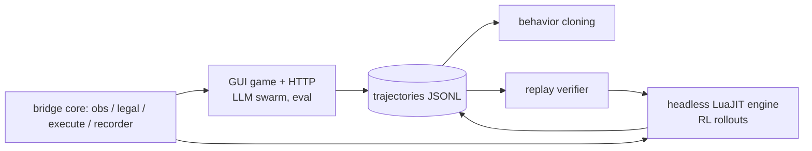

# Training Plan: From-Scratch Balatro Policy

Target: win Black Deck / Gold Stake (8) runs using the full vanilla action space. Decisions already made:

| Area | Decision |
|---|---|
| Training environment | Headless real Lua engine (unmodified game source under LuaJIT, rendering and animation removed) |
| Policy | Entity transformer with factored, autoregressive pointer heads, plus a value head |
| LLM swarm data | Behavior-cloning warm start, reasoning-text corpus, simulator validation oracle |
| Mods | Lovely only (vanilla game logic); no Steamodded |
| Profiles | Everything unlocked and discovered, always |
| Compute | Local (RTX 4070 Ti 12GB, Ryzen 7 9700X 8C/16T, 31GB) plus occasional rented cloud |
| Legacy Mac runs (~304 post-mortems) | Strategy knowledge only; not training data |

## 1. One interface everywhere

The bridge's state extractor, legality function, and action executor (`main.lua`) are the single definition
of what the policy sees and can do. They run in three hosts:

Because recorded trajectories are `seed + actions` plus checkpoints of the observation, any of them can be
replayed in the headless engine. That is both the fidelity test for the headless engine (it must reproduce
every recorded `obs`) and the way to regenerate observations if the observation schema changes later.

## 2. Headless engine

- Load the game source from `Balatro.exe` at runtime (never redistributed). Stub `love.graphics`, `love.audio`
  and the window; keep `love.filesystem`, `love.math` and the timer.
- Drive `G.E_MANAGER` with a fixed virtual `dt` until the event queue has no blocking events (the same
  "settled" predicate the bridge uses), then hand control to the policy. Animations become zero-cost.
- Expose a batched step API to Python (subprocess pool over pipes first; LuaJIT FFI or a shared library later).
- Acceptance: replays 100% of the swarm's `replay_ok` trajectories with identical observations, and reaches
  at least 300 steps/s per core (to be measured; a run is about 300-600 decisions).
- Implementation, setup and current fidelity/throughput numbers: `docs/HEADLESS.md`.

## 3. Observation encoding

Entity tokens, each = type embedding + key embedding (stable vocab built from `G.P_CENTERS` keys, not `hash()`)
+ numeric features + area/position embedding:

- Playing cards in hand, in pack, in shop; the full deck as a multiset (View Deck), with draw-pile membership
- Jokers (with ability/counter fields, stickers, edition, debuff), consumables, vouchers, tags
- Blinds (small/big/boss, chips, boss key, dynamic boss state), shop slots
- Global token: money, ante, round, hands/discards, hand levels and play counts, stake, deck, phase, run counters

## 4. Action decoding

Autoregressive heads, all masked by the bridge's legality data:

1. `action_type` (about 20 types)
2. Pointer(s) into the relevant entity set: one entity (buy/sell/use/pick), or a subset as a pointer sequence
   ending in `STOP` (play/discard/targets; size bounds from legality)
3. `REORDER`: generate the permutation one pointer at a time, or use atomic `move i -> j` actions
   (equivalent; derived from recorded permutations at training time)

## 5. Training stages

1. **Behavior cloning** on the swarm trajectories that pass validation (`schema_ok && replay_ok`), with winning
   and deep runs weighted up. Auxiliary targets: value = final ante reached; optionally predicting the scored chips.
2. **PPO** (or IMPALA/V-trace) in the headless engine. Reward = blinds cleared + ante progress + a win bonus,
   with a small KL penalty to the behavior-cloned policy early on.
   - Curriculum: White to Gold stake, with snapshot start states taken from swarm trajectories.
3. **Evaluation** on a fixed held-out seed list the swarm never plays: win rate per stake, mean ante, and
   comparison against the swarm's win rate.
4. Later: tree search at decision time (the engine is cloneable), with chance nodes for draws and shops.

## 6. Data requirements for the swarm (now)

See `docs/DATA_CONTRACT.md`. In short: every action goes through the bridge recorder, only legal actions at
settled decision points are executed, seeds and versions are recorded, every action carries a one-line
`--why`, and every run is replay-verified before it counts.
